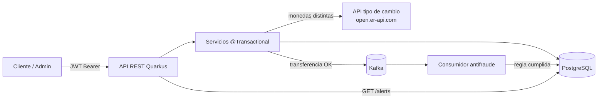

# MiniBanco - API bancaria con Quarkus

Proyecto de evidencia para la capacitación de **Quarkus**. Implementa un mini
banco: gestión de clientes y cuentas, depósitos, transferencias (mismo moneda y
entre monedas), y un motor antifraude que genera **alertas** a partir de eventos
de transferencia publicados en **Kafka**.

## Proceso de negocio

1. Un **administrador** da de alta clientes y abre cuentas (PEN o USD).
2. Un **cliente** (rol `CUSTOMER`) deposita y transfiere dinero.
3. Si la transferencia es entre monedas distintas, la app consulta una **API
   externa de tipo de cambio** (con tolerancia a fallos) y guarda la tasa aplicada.
4. Al confirmarse la transacción, se publica un evento en **Kafka**.
5. Un **consumidor antifraude** evalúa la regla de negocio y, si se cumple,
   persiste una **Alerta** (consultable solo por administradores).

### Diagrama de flujo



```
 Cliente/Admin ──JWT──▶ REST ──▶ Service @Transactional ──▶ PostgreSQL
                                    │
                                    ├─(distinta moneda)─▶ API tipo de cambio (Fallback/Timeout)
                                    └─(transferencia OK)─▶ Kafka "transfers"
                                                                   │
                                                                   ▼
                                                     Consumidor antifraude
                                                                   │
                                                          (regla) ─┴─▶ Alerta (PostgreSQL)
```

## Stack

| Componente            | Tecnología |
|-----------------------|------------|
| Framework             | Quarkus 3.40.1 (Java 21) |
| Persistencia          | Hibernate ORM + Panache, PostgreSQL |
| API                   | Quarkus REST (Jakarta REST), DTOs + mappers |
| Validación            | Hibernate Validator (`@Valid`, `@NotNull`, `@Positive`, ...) |
| Seguridad             | SmallRye JWT (RSA), `@RolesAllowed` |
| API externa           | REST Client (MicroProfile) + Fault Tolerance (`@Timeout`, `@Fallback`) |
| Mensajería            | Kafka (SmallRye Reactive Messaging) |
| Contenedores          | Podman + podman-compose |

## Estructura de capas

```
resource/     Endpoints REST (HTTP status, validación, roles)
service/      Lógica de negocio (@Transactional)
repository/   PanacheRepository (consultas)
entity/       Modelo JPA (Customer, Account, Transaction, Alert)
dto/          request/ y response/ separados de las entidades
mapper/       BankMapper (entidad -> DTO)
messaging/    Productor/consumidor Kafka y evento
client/       ExchangeRateClient (@RegisterRestClient)
exception/    Excepciones + ExceptionMapper (error JSON uniforme)
security/     Constantes de roles
```

## Cómo levantarlo con Podman

### Requisitos

- Podman (con una máquina corriendo: `podman machine start`).
- Java 21 + Maven Wrapper (incluido `mvnw`).

> El proyecto está configurado para usar **Podman puro**: `podman compose` invoca
> a **`podman-compose`** (no al `docker-compose` de Docker Desktop). En Windows,
> instala `podman-compose` con `pip install podman-compose` y registra el proveedor
> en `%APPDATA%\containers\containers.conf`:
>
> ```toml
> [engine]
> compose_providers=['C:\ruta\a\Scripts\podman-compose.exe']
> ```

### Pasos

```bash
# 1) (Opcional pero recomendado) Autenticarse en Docker Hub para evitar el
#    límite de descargas anónimas
podman login docker.io

# 2) Compilar la aplicación (genera target/quarkus-app)
./mvnw package

# 3) Levantar el stack completo (postgres + kafka + minibanco)
podman compose -f podman-compose.yml up --build -d

# 4) Ver el estado
podman compose -f podman-compose.yml ps
```

La API queda disponible en `http://localhost:8080/api`.

> El `minibanco` se construye con el **`Containerfile`** de la raíz (equivalente
> al `src/main/docker/Dockerfile.jvm` que genera Quarkus). El comando
> `podman compose ... up --build -d` ya usa `podman-compose`, por lo que no se
> requiere Docker. También puedes ejecutar directamente
> `podman-compose -f podman-compose.yml up --build -d` si tienes `podman-compose`
> en el `PATH`.

### Detener / limpiar

```bash
podman compose -f podman-compose.yml down        # detener
podman compose -f podman-compose.yml down -v     # detener y borrar datos
```

### Servicios del compose

| Servicio   | Imagen                                  | Puerto host | Notas |
|------------|-----------------------------------------|-------------|-------|
| postgres   | `docker.io/library/postgres:16-alpine`  | `5434`      | healthcheck `pg_isready` |
| kafka      | `docker.io/apache/kafka:4.2.0`          | —           | broker Apache Kafka (KRaft) en `kafka:9092` |
| minibanco  | build local (`Containerfile`)           | `8080`      | perfil `prod`, se conecta por nombre de servicio |

## Datos de prueba (se siembran automáticamente)

**Usuarios de prueba** (login simple, sin base de datos):

| Usuario    | Contraseña    | Rol       |
|------------|---------------|-----------|
| `admin`    | `admin123`    | `ADMIN`   |
| `customer` | `customer123` | `CUSTOMER`|

**Clientes y cuentas**:

| Cliente     | Documento  | Cuenta        | Moneda | Saldo inicial |
|-------------|------------|---------------|--------|---------------|
| Ana Rojas   | 45678912   | `PEN-000001`  | PEN    | 10000.00 |
| Ana Rojas   | 45678912   | `USD-000001`  | USD    | 6000.00  |
| Luis Perez  | 87654321   | `PEN-000002`  | PEN    | 2500.00  |

## Cómo obtener el token

```bash
TOKEN=$(curl -s -X POST http://localhost:8080/api/auth/login \
  -H "Content-Type: application/json" \
  -d '{"username":"admin","password":"admin123"}' | jq -r .accessToken)
```

Respuesta del login:

```json
{ "accessToken": "eyJ...", "tokenType": "Bearer", "expiresIn": 3600 }
```

## Endpoints principales

| Método | Ruta | Rol | Descripción |
|--------|------|-----|-------------|
| POST   | `/api/auth/login` | público | Emite un JWT |
| GET    | `/api/customers` | ADMIN | Lista clientes |
| POST   | `/api/customers` | ADMIN | Crea cliente |
| GET    | `/api/customers/{id}` | ADMIN | Detalle de cliente |
| PUT    | `/api/customers/{id}` | ADMIN | Actualiza cliente |
| DELETE | `/api/customers/{id}` | ADMIN | Elimina cliente |
| POST   | `/api/accounts` | CUSTOMER, ADMIN | Abre cuenta |
| GET    | `/api/accounts/{number}` | CUSTOMER, ADMIN | Detalle de cuenta |
| DELETE | `/api/accounts/{number}` | ADMIN | Cierra cuenta (saldo 0) |
| POST   | `/api/accounts/{number}/deposits` | CUSTOMER | Depósito |
| POST   | `/api/accounts/{number}/transfers` | CUSTOMER | Transferencia |
| GET    | `/api/transactions` | ADMIN | Lista transacciones |
| GET    | `/api/transactions/{id}` | ADMIN | Detalle de transacción |
| GET    | `/api/alerts` | ADMIN | Lista alertas antifraude |

### Ejemplos `curl`

```bash
BASE=http://localhost:8080/api

# Token de admin y de cliente
ADMIN_TOKEN=$(curl -s -X POST $BASE/auth/login -H "Content-Type: application/json" \
  -d '{"username":"admin","password":"admin123"}' | jq -r .accessToken)
CUSTOMER_TOKEN=$(curl -s -X POST $BASE/auth/login -H "Content-Type: application/json" \
  -d '{"username":"customer","password":"customer123"}' | jq -r .accessToken)

# Crear cliente (ADMIN)
curl -s -X POST $BASE/customers -H "Authorization: Bearer $ADMIN_TOKEN" \
  -H "Content-Type: application/json" \
  -d '{"name":"Carlos Test","document":"11112222","email":"carlos@minibanco.test"}'

# Abrir cuenta (ADMIN) para el cliente con id 1
curl -s -X POST $BASE/accounts -H "Authorization: Bearer $ADMIN_TOKEN" \
  -H "Content-Type: application/json" \
  -d '{"number":"PEN-000003","customerId":1,"currency":"PEN"}'

# Depósito (CUSTOMER)
curl -s -X POST $BASE/accounts/PEN-000001/deposits -H "Authorization: Bearer $CUSTOMER_TOKEN" \
  -H "Content-Type: application/json" \
  -d '{"amount":500.00,"description":"Deposito demo"}'

# Transferencia misma moneda (CUSTOMER)
curl -s -X POST $BASE/accounts/PEN-000001/transfers -H "Authorization: Bearer $CUSTOMER_TOKEN" \
  -H "Content-Type: application/json" \
  -d '{"destinationAccountNumber":"PEN-000002","amount":100.00,"description":"Transferencia demo"}'

# Transferencia entre monedas (CUSTOMER) -> usa el tipo de cambio externo
curl -s -X POST $BASE/accounts/PEN-000001/transfers -H "Authorization: Bearer $CUSTOMER_TOKEN" \
  -H "Content-Type: application/json" \
  -d '{"destinationAccountNumber":"USD-000001","amount":200.00,"description":"Cambio PEN->USD"}'

# Consultar cuenta
curl -s $BASE/accounts/PEN-000001 -H "Authorization: Bearer $ADMIN_TOKEN"

# Listar transacciones (ADMIN)
curl -s $BASE/transactions -H "Authorization: Bearer $ADMIN_TOKEN"

# Listar alertas antifraude (ADMIN)
curl -s $BASE/alerts -H "Authorization: Bearer $ADMIN_TOKEN"
```

## Reglas de antifraude

El consumidor Kafka, por cada transferencia, genera una alerta si:

- El monto convertido supera **USD 5000**, o
- Se registran **5 o más transferencias** desde la misma cuenta en **5 minutos**.

## Códigos HTTP

| Código | Cuándo |
|--------|--------|
| 201 | Recurso creado (cliente, cuenta, depósito, transferencia) |
| 204 | Recurso cerrado/eliminado |
| 400 | Error de validación (`VALIDATION_ERROR`) |
| 401 | Credenciales inválidas / sin token |
| 403 | Rol insuficiente |
| 404 | Recurso no encontrado (`ACCOUNT_NOT_FOUND`, ...) |
| 409 | Conflicto (`CUSTOMER_DOCUMENT_ALREADY_EXISTS`, ...) |
| 422 | Regla de negocio (`INSUFFICIENT_BALANCE`, ...) |
| 503 | API de tipo de cambio no disponible |

Todas las excepciones devuelven un JSON uniforme:

```json
{ "code": "INSUFFICIENT_BALANCE", "message": "Insufficient balance: ...", "timestamp": "2026-01-01T00:00:00Z" }
```

## Documentación interactiva (OpenAPI / Swagger UI)

En modo desarrollo (`./mvnw quarkus:dev`):

- Dev UI: <http://localhost:8080/q/dev/>
- Swagger UI: <http://localhost:8080/q/swagger-ui/>

## Desarrollo local (sin contenedores para la app)

```bash
./mvnw quarkus:dev
```

Quarkus levanta automáticamente **PostgreSQL** y **Kafka** con *Dev Services*
(requiere un runtime de contenedores disponible).

## Pruebas

```bash
./mvnw test
```

Los tests de integración usan Dev Services (PostgreSQL + Kafka) y mockean
`ExchangeRateClient`.
