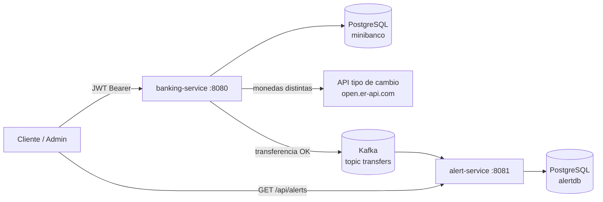

# MiniBanco - Arquitectura de microservicios con Quarkus

Proyecto de evidencia para la capacitación de **Quarkus**. Implementa un mini
banco dividido en dos backends independientes que se comunican de forma
asíncrona mediante **Kafka**:

- **`banking-service`**: clientes, cuentas, depósitos, transferencias y consulta
  de transacciones. Es el dueño de la base de datos bancaria y el productor de
  los eventos de transferencia.
- **`alert-service`**: consumidor antifraude. Evalúa los eventos, persiste las
  alertas en su propia base de datos y las expone por REST.

## Proceso de negocio

1. Un **administrador** da de alta clientes y abre cuentas (PEN o USD).
2. Un **cliente** (rol `CUSTOMER`) deposita y transfiere dinero.
3. Si la transferencia es entre monedas distintas, `banking-service` consulta
   una **API externa de tipo de cambio** (con timeout y fallback) y guarda la
   tasa aplicada.
4. Al confirmarse la transacción, `banking-service` publica un
   `TransferCompletedEvent` en el tópico Kafka `transfers`.
5. `alert-service` consume el evento, aplica las reglas antifraude y, si
   corresponde, persiste una **Alerta** en su propia BD.
6. Un administrador consulta las alertas en `alert-service`.

### Diagrama de flujo



```
 Cliente/Admin ──JWT──▶ banking-service ──▶ PostgreSQL (minibanco)
                              │
                              ├─(distinta moneda)─▶ API tipo de cambio
                              └─(transferencia OK)─▶ Kafka "transfers"
                                                           │
                                                           ▼
                                                    alert-service
                                                           │
                                                           ├─▶ PostgreSQL (alertdb)
                                                           └─▶ GET /api/alerts (ADMIN)
```

## Stack

| Componente            | Tecnología |
|-----------------------|------------|
| Framework             | Quarkus 3.40.1 (Java 21) |
| Persistencia          | Hibernate ORM + Panache, PostgreSQL |
| API                   | Quarkus REST (Jakarta REST), DTOs + mappers |
| Validación            | Hibernate Validator (`@Valid`, `@NotNull`, `@Positive`, ...) |
| Seguridad             | SmallRye JWT (RSA), `@RolesAllowed` |
| API externa           | REST Client (MicroProfile) + Fault Tolerance (`@Timeout`, `@Fallback`) |
| Mensajería            | Kafka (SmallRye Reactive Messaging) |
| Contenedores          | Podman + podman-compose |

## Estructura del repositorio

```
.
├── pom.xml                     # POM agregador (parent de los dos módulos)
├── mvnw / mvnw.cmd / .mvn/     # Maven Wrapper compartido
├── podman-compose.yml          # PostgreSQL x2 + Kafka + los dos backends
├── banking-service/
│   ├── pom.xml
│   ├── Containerfile
│   └── src/
│       ├── main/java/org/acme/
│       │   ├── resource/       # Auth, Customer, Account, Transaction
│       │   ├── service/        # Lógica bancaria y tipo de cambio
│       │   ├── repository/     # Panache
│       │   ├── entity/         # Customer, Account, Transaction
│       │   ├── dto/ + mapper/
│       │   ├── messaging/      # TransferCompletedEvent + productor Kafka
│       │   ├── client/         # ExchangeRateClient
│       │   ├── exception/      # Excepciones + ExceptionMapper
│       │   └── security/       # Roles
│       └── main/resources/     # application.properties, claves JWT
└── alert-service/
    ├── pom.xml
    ├── Containerfile
    └── src/
        ├── main/java/org/acme/
        │   ├── resource/       # AlertResource
        │   ├── service/        # AlertService
        │   ├── repository/     # AlertRepository, ProcessedTransferRepository
        │   ├── entity/         # Alert, ProcessedTransfer, Currency
        │   ├── dto/
        │   ├── messaging/      # Consumidor Kafka + evento/deserializador
        │   └── security/       # Roles
        └── main/resources/     # application.properties, publicKey.pem
```

## Cómo levantarlo con Podman

### Requisitos

- Podman con una máquina corriendo (`podman machine start`).
- Java 21 + Maven Wrapper (incluido `mvnw`).
- `podman-compose` (en Windows se integra con `podman compose`).

### Pasos

```bash
# 1) (Opcional) Autenticarse en Docker Hub para evitar límites de descarga
podman login docker.io

# 2) Compilar ambos módulos (genera target/quarkus-app en cada uno)
./mvnw package

# 3) Construir imágenes y levantar todo el stack
podman compose -f podman-compose.yml up --build -d

# 4) Ver el estado
podman compose -f podman-compose.yml ps
```

Servicios disponibles:

- API bancaria: `http://localhost:8080/api`
- API de alertas: `http://localhost:8081/api`
- Swagger UI bancario: `http://localhost:8080/q/swagger-ui/`
- Swagger UI alertas: `http://localhost:8081/q/swagger-ui/`

> Cada módulo tiene su propio `Containerfile` (runtime JVM sobre
> `ubi9/openjdk-21-runtime`). `podman compose ... --build` construye ambas
> imágenes usando como contexto la carpeta de cada servicio. No se requiere
> Docker Desktop.

### Detener / limpiar

```bash
podman compose -f podman-compose.yml down        # detener
podman compose -f podman-compose.yml down -v     # detener y borrar datos
```

### Servicios del compose

| Servicio       | Imagen                                  | Puerto host | Notas |
|----------------|-----------------------------------------|-------------|-------|
| postgres       | `docker.io/library/postgres:16-alpine`  | `5434`      | BD de `banking-service` (`minibanco`) |
| postgres-alert | `docker.io/library/postgres:16-alpine`  | `5435`      | BD de `alert-service` (`alertdb`) |
| kafka          | `docker.io/apache/kafka:4.2.0`          | `9092`      | KRaft, listeners interno `kafka:9092` y externo `localhost:9092` |
| banking-service| build local (`banking-service/Containerfile`) | `8080` | perfil `prod`, produce en `transfers` |
| alert-service  | build local (`alert-service/Containerfile`)   | `8081` | perfil `prod`, consume `transfers` |

El tópico `transfers` se crea automáticamente (3 particiones). El productor usa
`sourceAccountNumber` como **clave**, de modo que las transferencias de una
misma cuenta caen en la misma partición y se consumen en orden.

## Datos de prueba (se siembran en `banking-service`)

**Usuarios de prueba** (login simple, sin base de datos):

| Usuario    | Contraseña    | Rol       |
|------------|---------------|-----------|
| `admin`    | `admin123`    | `ADMIN`   |
| `customer` | `customer123` | `CUSTOMER`|

**Clientes y cuentas**:

| Cliente     | Documento  | Cuenta        | Moneda | Saldo inicial |
|-------------|------------|---------------|--------|---------------|
| Ana Rojas   | 45678912   | `PEN-000001`  | PEN    | 10000.00 |
| Ana Rojas   | 45678912   | `USD-000001`  | USD    | 6000.00  |
| Luis Perez  | 87654321   | `PEN-000002`  | PEN    | 2500.00  |

`alert-service` no siembra datos: las alertas se generan a partir de los
eventos de transferencia.

## Seguridad entre servicios

- `banking-service` emite el JWT en `POST /api/auth/login`, firmado con
  `privateKey.pem` (claim `groups` con el rol).
- `alert-service` **no emite tokens**: valida el mismo JWT con `publicKey.pem` y
  el issuer `minibanco-api`.
- Por eso el token obtenido en el puerto `8080` se usa también para consultar
  `GET http://localhost:8081/api/alerts` con rol `ADMIN`.

## Endpoints

### `banking-service` (`http://localhost:8080/api`)

| Método | Ruta | Rol | Descripción |
|--------|------|-----|-------------|
| POST   | `/api/auth/login` | público | Emite un JWT |
| GET    | `/api/customers` | ADMIN | Lista clientes |
| POST   | `/api/customers` | ADMIN | Crea cliente |
| GET    | `/api/customers/{id}` | ADMIN | Detalle de cliente |
| PUT    | `/api/customers/{id}` | ADMIN | Actualiza cliente |
| DELETE | `/api/customers/{id}` | ADMIN | Elimina cliente |
| POST   | `/api/accounts` | CUSTOMER, ADMIN | Abre cuenta |
| GET    | `/api/accounts/{number}` | CUSTOMER, ADMIN | Detalle de cuenta |
| DELETE | `/api/accounts/{number}` | ADMIN | Cierra cuenta (saldo 0) |
| POST   | `/api/accounts/{number}/deposits` | CUSTOMER | Depósito |
| POST   | `/api/accounts/{number}/transfers` | CUSTOMER | Transferencia |
| GET    | `/api/transactions` | ADMIN | Lista transacciones |
| GET    | `/api/transactions/{id}` | ADMIN | Detalle de transacción |

### `alert-service` (`http://localhost:8081/api`)

| Método | Ruta | Rol | Descripción |
|--------|------|-----|-------------|
| GET    | `/api/alerts` | ADMIN | Lista alertas antifraude |

### Ejemplos `curl`

```bash
BANK=http://localhost:8080/api
ALERTS=http://localhost:8081/api

# Tokens (se emiten en banking-service)
ADMIN_TOKEN=$(curl -s -X POST $BANK/auth/login -H "Content-Type: application/json" \
  -d '{"username":"admin","password":"admin123"}' | jq -r .accessToken)
CUSTOMER_TOKEN=$(curl -s -X POST $BANK/auth/login -H "Content-Type: application/json" \
  -d '{"username":"customer","password":"customer123"}' | jq -r .accessToken)

# Crear cliente (ADMIN)
curl -s -X POST $BANK/customers -H "Authorization: Bearer $ADMIN_TOKEN" \
  -H "Content-Type: application/json" \
  -d '{"name":"Carlos Test","document":"11112222","email":"carlos@minibanco.test"}'

# Abrir cuenta (ADMIN)
curl -s -X POST $BANK/accounts -H "Authorization: Bearer $ADMIN_TOKEN" \
  -H "Content-Type: application/json" \
  -d '{"number":"PEN-000003","customerId":1,"currency":"PEN"}'

# Depósito (CUSTOMER)
curl -s -X POST $BANK/accounts/PEN-000001/deposits -H "Authorization: Bearer $CUSTOMER_TOKEN" \
  -H "Content-Type: application/json" \
  -d '{"amount":500.00,"description":"Deposito demo"}'

# Transferencia misma moneda (CUSTOMER)
curl -s -X POST $BANK/accounts/PEN-000001/transfers -H "Authorization: Bearer $CUSTOMER_TOKEN" \
  -H "Content-Type: application/json" \
  -d '{"destinationAccountNumber":"PEN-000002","amount":100.00,"description":"Transferencia demo"}'

# Transferencia entre monedas (CUSTOMER) -> usa el tipo de cambio externo
curl -s -X POST $BANK/accounts/PEN-000001/transfers -H "Authorization: Bearer $CUSTOMER_TOKEN" \
  -H "Content-Type: application/json" \
  -d '{"destinationAccountNumber":"USD-000001","amount":200.00,"description":"Cambio PEN->USD"}'

# Listar transacciones (ADMIN)
curl -s $BANK/transactions -H "Authorization: Bearer $ADMIN_TOKEN"

# Listar alertas antifraude (ADMIN) en el OTRO servicio
curl -s $ALERTS/alerts -H "Authorization: Bearer $ADMIN_TOKEN"
```

## Reglas de antifraude

`alert-service` evalúa cada `TransferCompletedEvent` y genera una alerta si:

- El monto convertido supera **USD 5000**, o
- Se registran **5 o más transferencias** desde la misma cuenta en **5 minutos**.

Para la segunda regla, `alert-service` guarda su propia copia de cada evento en
la tabla `processed_transfers`; así no consulta la base de datos de
`banking-service`. La tabla tiene un índice único por `transaction_id` y
`alerts` también, lo que hace el consumo **idempotente** ante reentregas de
Kafka (semántica *at-least-once*).

## Códigos HTTP

| Código | Cuándo |
|--------|--------|
| 201 | Recurso creado (cliente, cuenta, depósito, transferencia) |
| 204 | Recurso cerrado/eliminado |
| 400 | Error de validación (`VALIDATION_ERROR`) |
| 401 | Credenciales inválidas / sin token |
| 403 | Rol insuficiente |
| 404 | Recurso no encontrado (`ACCOUNT_NOT_FOUND`, ...) |
| 409 | Conflicto (`CUSTOMER_DOCUMENT_ALREADY_EXISTS`, ...) |
| 422 | Regla de negocio (`INSUFFICIENT_BALANCE`, ...) |
| 503 | API de tipo de cambio no disponible |

Todas las excepciones de `banking-service` devuelven un JSON uniforme:

```json
{ "code": "INSUFFICIENT_BALANCE", "message": "Insufficient balance: ...", "timestamp": "2026-01-01T00:00:00Z" }
```

## Documentación interactiva (OpenAPI / Swagger UI)

Con el stack levantado:

- Banking: `http://localhost:8080/q/swagger-ui/`
- Alerts: `http://localhost:8081/q/swagger-ui/`

## Desarrollo local (sin contenedores para las apps)

Kafka debe estar corriendo en `localhost:9092`; se puede levantar solo el broker
con Podman:

```bash
podman compose -f podman-compose.yml up -d kafka
```

Luego, en dos terminales:

```bash
# Terminal 1 - servicio bancario (Dev Services levanta su PostgreSQL)
./mvnw -pl banking-service quarkus:dev

# Terminal 2 - servicio de alertas (Dev Services levanta su PostgreSQL en 5433)
./mvnw -pl alert-service quarkus:dev
```

En modo `dev`, ambos servicios están configurados para usar el Kafka externo en
`localhost:9092` y **no** levantar un Kafka por Dev Services. Cada uno sí levanta
su PostgreSQL con Dev Services (puertos `5432` y `5433`).

No mezcles el stack completo de compose con `quarkus:dev`: ambos intentarían
usar el puerto `8080` (banking) o `8081` (alerts).

## Pruebas

```bash
# Ambos módulos
./mvnw test

# Solo uno
./mvnw -pl banking-service test
./mvnw -pl alert-service test
```

- `banking-service`: tests de recursos, persistencia, seguridad y tipo de cambio.
- `alert-service`: tests del consumidor Kafka y del endpoint `/alerts`
  (incluye 401 sin token y 403 para `CUSTOMER`).
- Los tests usan **Dev Services** (PostgreSQL + Kafka) con Testcontainers sobre
  Podman.

## Notas de diseño

- Cada servicio es dueño de su base de datos; no hay acceso cruzado a tablas.
- El contrato es el evento JSON `TransferCompletedEvent`, replicado en ambos
  módulos. En una evolución real se podría extraer a una librería compartida o
  usar un Schema Registry (Avro/Protobuf).
- `banking-service` publica el evento **después del commit** de la transacción
  (`@Observes(during = AFTER_SUCCESS)`), evitando alertas de transferencias que
  finalmente fallaron.
- El envío a Kafka es *fire-and-forget*: si Kafka no está disponible, la
  transferencia ya confirmada no se revierte. Para garantías más fuertes se
  podría implementar el patrón **Transactional Outbox**.
